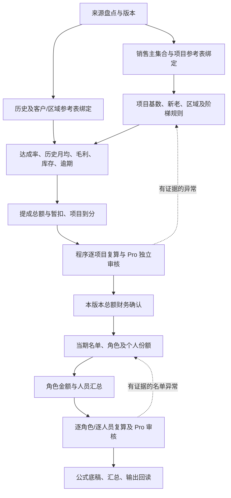

# 提成奖金固定链路：设计、迁移与验收

## 为什么改变架构

历次自由编制把材料理解、数据关系、规则抽取、公式语法、独立复核、纠错与报表设计同时交给模型。一个成功的工具调用只是局部语法或保存成功，不等于业务语义正确。继续扩大窗口或换模型不能消除数据粒度错误、重复任务所有权和阶段之间的依赖冲突。

固定链路不固化企业本期费率、客户、月份、名单和参考金额。固化的是提成奖金这一业务类型的语义位置、操作接口、数据流、验收及返回责任节点的方式。规则、数据和映射均绑定本次材料指纹。当前版本支持按完整单月、项目四维主键、项目阶梯与考核系数、分类暂扣、角色份额、人员汇总这类业务结构；新增指标、改变根本核算粒度、复杂跨期发放等超出已有算子的制度，需要明确新增节点/算子或选原通用编制流程，不能默默按旧规则计算。

## 计算链路

真实节点描述在 `bonus_agent/scenarios/packs/sales_commission/chain.yaml`；实现入口由 `scenario.yaml` 的 `execution: sales_commission_v1` 选择。旧的通用案卷续跑仍保留原路径，新建编制案卷或明确重新编制时使用新链路。不要对已有失败案卷直接复用旧草稿当作冷启动成功。

## 各节点的输入、提示词与验收条件

| 节点 | 当前模型上下文（不附其他阶段历史） | 程序交付和验收 | 处理过的典型错误 |
|---|---|---|---|
| inventory | 无模型；文件、页标题、实际表名及字段索引 | 指纹、行列坐标、源块 ID、有效期间；答案与执行材料隔离 | 材料遗漏、错页、上下文过长 |
| scope_mapping | 项目定义、客户端已确认的键口径、销售/首发/毛利/欠款表的实际列和样例 | 固定语义字段→物理列；销售单创建项目，参考表不新增项目；核对期间与主外键，重复和缺项列示 | 同名列、送达方编码混淆、缺主键、虚构字段、参考表行污染 |
| reference_mapping | 客户/区域粒度、预算、本年历史、风险余额原文；相应表的列及实际月份覆盖 | 月份与金额列对应；从原件统计历史月份及客户实际出货覆盖，核对当期逐客户金额；发现唯一完整且可逐客对账的历史源时自动纠正，另行复核新绑定；历史材料确实缺失才询问财务 | T17-2、T22-2、T23-3、T31、T33 的月均或作用域问题 |
| project_policy | 销售排除、计算基数、新老、阶梯算法、负数、区域例外；当前区域实际枚举和阶梯制度表 | 原文数值/例外、严格年龄阈值、每区域新老两列和区间端点；程序从单元格取数、检查边界 | 错页、漏档、首档上界误作下界、BIU/ODM误分、美洲新老混用 |
| coefficient_policy | 区域/客户达成率、年内历史月均、各系数表、明确的缺值和边界口径 | 分别绑定区域行和客户行；按实际区域映射毛利表；缺失比例与采用系数分开，0% 不按缺失；端点逐档验证 | 参数错绑、低可信度指标、区域毛利误用PI、预算与月均合并 |
| hold_policy | 提成总额的乘数、分类暂扣及欠款书面规则、项目舍入原文 | 计算去向账平；匹配名单按本批冻结政策，不重复暂扣；项目原值和到分金额分开 | 把扣减相乘当相加、冻结一笔重复列支、人员舍入错绑项目 |
| basis | 无模型运算；上述绑定和当期原始行 | 每个项目从销售源得出全部中间指标及来源；程序以独立有理数恒等式检查阶梯、金额和边界；保存逐项目回执 | 主算/复核相差总额却无具体项目、金额计算先天错误 |
| basis_review | 代表性的地区×新老×负数×缺值×冻结项目、相关原文与可追溯中间指标 | Pro 在独立会话核对分支与证据，不再让其从头重写全部DSL；每个真实项目另有程序独立算术检查 | 模型算错金额、全局总额复核不可定位、错误纠错对象 |
| confirm_basis | 不发模型请求 | 财务真实确认本版指纹与金额，确认前无正式个人结果；资料或规则变更需重新复算 | 阶段错位、假审批、过期总额回执 |
| roster | 已确认项目集合、角色比例制度表、当期名单的相关列、分配与舍入书面规则 | 角色表逐行逐列实际取值、按期间四键匹配、姓名及份额、Q文字优先/空Q按已确认口径、缺份额和待分配；超分阻断 | T10比例单位、T21姓名与Q不同、空Q错误待分配、NPD缺失 |
| settlement | 无模型运算 | 项目到分金额×制度角色份额×名单个人份额；逐项目金额原值守恒；人员/待分配按当期舍入规则汇总，尾差单列 | 任意归零负金额、逐条舍入误差、人员金额和项目资金不一致 |
| settlement_review | 按项目整组的完整角色样本（覆盖地区、新老、负值、分拆和冻结），实际名单及角色来源、舍入回执 | Pro 独立验证名单与制度适用性，程序逐条角色原值及人员汇总核对；样例组不能漏掉另一名分配人员 | 总金额一致但人员错位、两类比例混淆、抽样丢掉第二人导致假差额 |
| export | 无模型 | 核算底稿、核算汇总、参数、角色明细、数据追溯、节点验收；Excel公式和确定性缓存同版本，回读项目/人员/总额 | 汇总/角色漏列、旧版本文件、未验证即交付 |

## 动态提示词与纠错

- 每次模型请求全新会话。只发当前节点所需的规则原文、源表坐标索引、直接依赖的绑定/数据摘要与该节点的财务答复。不传已完成节点的长对话或整份历史失败日志，也不把场景全部说明和全局工具集循环附上。
- 阶梯表、系数表和角色表分批读取。模型只选择表/行/列、运算类型及有来源的口径，程序从原单元格取数、归一化单位、验证区间及实际分支；不接受模型任意代码或最终答案。
- 每个候选先经过程序验证，再由独立 Pro 会话按同一原件复核。修正只替换本节点候选；验证失败时保留原工作区、最新反例和责任节点，重做受影响节点。真正的材料冲突才向财务提问，问题要列出原文、实际样例、选项及金额影响。
- 已通过的节点保存源文件指纹、节点输入/输出指纹、模型复核与本地校验回执。继续时只复用当前输入版本仍有效的回执；技术修复可重新验证同一案卷实际收到且已经接受的模型合同，不重新付费抽取，也不复用旧金额。人员审核/协议修复若不影响项目，只有在本案真实批准记录、全部原始材料、项目绑定合同、逐项目金额指纹及原独立审核完整输入均重新核对一致时，才可保留该真实批准，记录重验依据；否则重新取得真实总额确认。
- 用量由现有 `RunBudget` 台账记录，未知接口用量仍留痕；保留真实请求 ID 和返回。对相同失败的反例进行有限修复，不靠反复读取或强行结束来伪装成功。

## 本批规则所在位置

真正的公司规则和财务答复保存在本机场景材料中，不将本批数字或客户写入项目源码。`guide.md` 与本批指纹匹配的 `confirmations` 文件组成正式原文。特别是：Q 列有姓名及比例时优先用 Q；Q 为空时使用 O/P 现有姓名（一个姓名为100%）；都缺姓名才为未分配，多名无比例须提问。该确认适用本批材料；其他批次有新口径时重新解释。

## 验收与界限

真正冷启动只使用新案卷原始材料、正式确认依据与当前实现，不注入历史工作区或金额。逐节点记录实际 DeepSeek 响应、输出的合同、程序反例及修改；总额通过独立复核后取实际财务决策，计算人员，再冻结 Excel 和结构化结果，最后在本机用独立财务底稿逐键对比。一次同批通过只证明该批，不等于跨批规则变更已验收。另选一份独立真实数据和规则完成同样的冷启动验收之后，才可对稳定性和跨批使用给出更强的结论。

## 本次真实冷启动新增的反例

1. 候选附有 `missing: 无（已确认）` 的问题，Pro 已确认原件，但程序把所有问题都判阻断 → 区分真实缺项和已解决问题，保存真实复核，规范可接受的字段形状。
2. Pro 的长思考响应到达输出上限 → 固定节点短JSON、局部思考强度、已返回但截断的响应只进行一次协议恢复；已接受的其他节点保留。
3. 程序识别出Flash漏掉明确排除标记、系数边界全含的问题 → Pro只修正该节点，逐格读取真实原文数值，重新校验。
4. 独立项目审核只传了原始区域和阶梯表名，未传已确认BIU例外 → 提供适用条件、实际项目匹配结果与原始区域/阶梯路线各自的粒度依据；不改正确数据以迁就错误复核。
5. 人员比例列被模型表达成单元素数组或把完整策略误放在roster对象内 → 只归一化结构，不更换源数据；对真实姓名列及比例列仍同时检查物理坐标和口径。Q文字列不是空Q回退姓名列。
6. 独立人员审核把同一项目80%与20%份额中的一条抽出，却按完整项目报差额 → 对具体项目传完整角色集合及原值闭合证明。原批准资金及规则未变的，重新验证确切批准而不重复请求财务决策。
