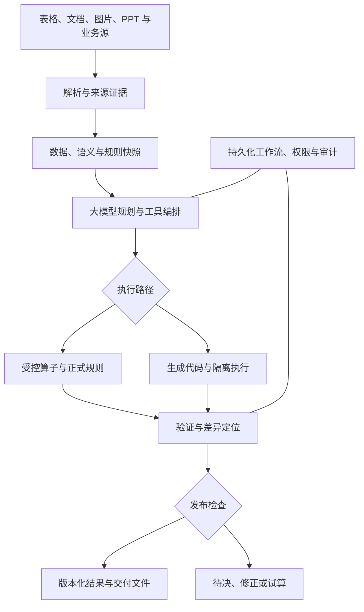
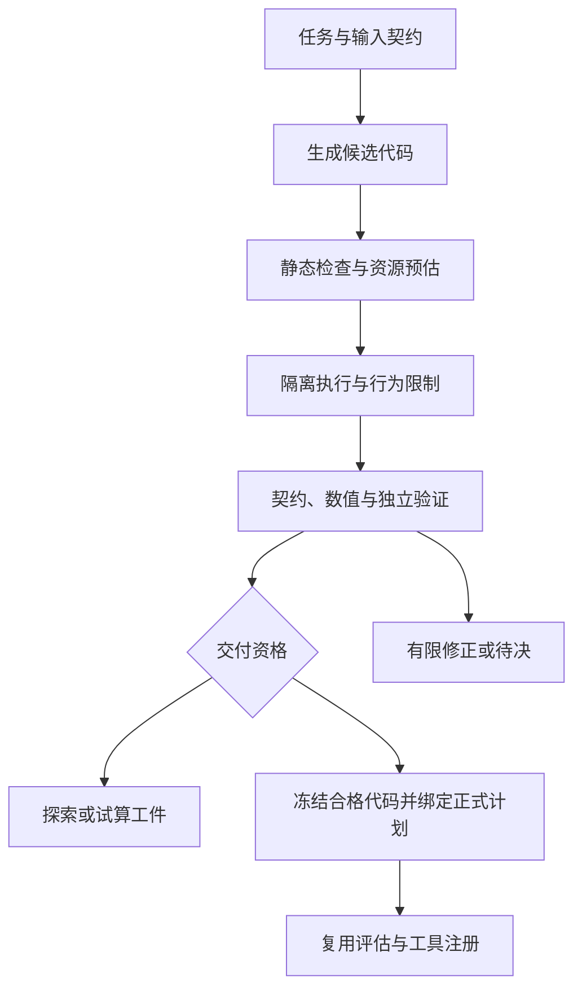

# 财务金融 AI 系统：统一架构与开发规范

## 0. 项目定义与阅读约定

构建一套可以理解表格、制度文档、票据图片、PDF 和 PPT，能够推理规划、编写并执行代码、处理多表关联与复杂规则、生成可追溯结果的财务金融 AI 系统。

系统采用 **大模型负责理解与推理，工具负责访问与操作，代码负责计算，验证器负责检查，持久化工作流负责连续执行** 的协作方式。新场景主要通过场景包、规则包和工具插件接入，数据规模变化主要由执行后端和资源计划适配。

本文是合并、修正与扩展两个输入方案形成的开发规范，不是已经运行的系统。示例业务政策、接口、SDK 名称和性能测试档位均为设计输入；不代表已批准制度、已实现接口或已验证容量。未对任何现有代码仓库进行审查。

术语：MUST 为必须，MUST NOT 为禁止，SHOULD 为原则上实现。P0 为首个正式业务闭环必需；P1 为规模化与生产增强，涉及权限、恢复、备份的基础能力仍必须在生产上线前完成；P2 为复杂领域扩展。

开发 AI 应先读全文，再建立“需求 ID → 模块 → 契约 → 验收证据”映射。业务歧义只阻断受影响的正式结果，无关基础建设继续推进。

## 1. 两个方案的精华与修正

### 1.1 取长合并

| 来源 | 保留的核心 | 在统一系统中的实现 |
| --- | --- | --- |
| 《AI财务计算系统设计蓝图》 | 分层流水线、原始/标准/结果数据层、列式计算、计划校验、控制总数对账 | 数据底座、可编译计划、自适应执行、分层校验 |
| 《财务AI计算基座_架构与实施规范_v1.0》 | 精度契约、规则治理、冻结快照、关联基数、分配算法、恢复与发布 | 确定性内核、版本治理、工作流和证据体系 |
| 本次新增 | 大模型编程与执行、多格式智能工具、Agent 协作、跨场景适配 | 双执行路径、统一工具协议、场景包、角色工作流 |

### 1.2 不直接沿用的条款

| 原方案中容易误用的表达 | 统一规范 |
| --- | --- |
| 模型不能解释规则，只能引用已有规则 | 模型可以理解、解释和提出新规则；正式执行依据版本化且已获适用授权的规则工件。 |
| 明细绝对不能进入上下文 | 大表以引用和摘要流转；经过权限过滤的少量样本、异常明细和局部图像可以进入上下文。 |
| 中间不舍入，只在输出舍入 | 舍入时点服从已确认业务规则；逐行、分组和最终舍入都可建模，禁止隐式舍入。 |
| Decimal/decimal128 绝对精确 | 有限精度、除法、溢出和后端类型转换仍需检查；不可把类型名称当正确性证明。 |
| 整数分单位永远够用 | 按输入上限、行数、乘积和聚合推导容量；int64 正数上限为 2^63−1 个最小单位，不能忽略中间溢出。 |
| 两份相同快照必须得到相同文件哈希 | 要求规范化结构结果一致；Parquet 元数据、压缩和文档时间戳可能使文件字节不同。两种摘要分别保存。 |
| 容差随行数扩大，差异小就自动摊平 | 正式结算明细按最小单位精确核对；合法舍入调整有独立政策，源数据或规则差异不能靠摊平消除。 |
| 数据错误后删掉问题行继续成功 | 可生成部分试算，但不能宣称原发布范围全部成功；独立范围须预先定义。 |
| 财务三表几个同名指标天然相等 | 每条勾稽关系先定义范围、调整项和准则口径；现金与现金等价物不直接等同全部货币资金。 |
| Top-K 检索决定适用规则 | 检索用于找材料；程序按业务范围加载适用规则全集和依赖闭包。 |
| 固定行数决定后端、给出秒级速度 | 规模档位用于测试；路由依据字节、算子、分组倾斜、内存与磁盘，速度以实测为准。 |
| 近似分位数天然有可靠误差界 | 默认精确；近似算法单独声明方法及可验证的误差性质，不为算法虚构统一误差保证。 |
| 双引擎一致等于正确 | 还需独立期望、业务约束和来源检查；两条路径可能共享同一业务误解。 |

蓝图中的税额样例也需修正：若含税金额为 10001 分、示例税率为 13%，按含税价计算并 HALF_UP 到分，税额是 1151 分，即 11.51 元；不能混用“元保留两位”和“分保留两位”。此处是数学示例，不是税务政策。

## 2. 适配范围与能力层次

### 2.1 业务场景矩阵

| 场景 | 输入与核心处理 | 需要额外声明的业务语义 |
| --- | --- | --- |
| 奖金、佣金与激励 | 制度、人员、项目、收款、评分；资格、分层分配与尾差 | 授予/可发/暂缓/实付、固定额、封顶、未收款政策 |
| 经营分析与毛利归因 | 收入、成本、产品、客户、事业部、库存；多维分析 | 指标粒度、成本结转、价格/数量/结构分解、残差 |
| 费用、预算与报销 | 申请、票据、部门预算、付款流水；分类与核对 | 含税口径、额度、重复报销、预算占用和释放 |
| 银企对账与应收应付 | 银行流水、业务单、总账；匹配和差异定位 | 一对多/多对一匹配、手续费、在途、截止时点 |
| 发票、合同及单据识别 | 图片/PDF、合同、采购与验收；抽取和交叉核验 | 原文定位、关键字段复核、真实性检查的边界 |
| 库存、成本与分摊 | 入出库、工单、材料、人工、制造费用 | 计价方法、批次、成本中心、内部交易和负库存 |
| 利息、借款与摊销 | 合同、现金流、利率和业务日历 | 日计数、复利、重定价、节假日、提前还款、账期 |
| 估值、风险与组合分析 | 持仓、价格、曲线、情景和模型参数 | 模型版本、市场快照、数值误差、回测与不确定性 |

财务核算与金融建模共用接入、工具、状态、版本和证据底座；不假设一套公式能覆盖所有领域。估值、信用风险和监管报送须另建经过领域验证的场景包，不能从奖金功能直接推断具备这些能力。

### 2.2 三种任务交付等级

| 等级 | 可交付内容 | 约束 |
| --- | --- | --- |
| EXPLORE 探索 | 样本分析、候选映射、候选代码、假设性解释 | 明确样本范围与未决问题，不进入正式结果指针 |
| TRIAL 试算 | 在冻结假设下完整计算，列出差异与待决 | 可复现，但有未批准政策或未通过检查，不能标记正式 |
| OFFICIAL 正式 | 通过发布门槛的结果及必需文件 | 输入、规则、代码、检查和授权全部绑定具体版本 |

风险等级与交付等级分开保存。金额规模小不自动代表风险低；是否触及关账、付款、个人分配或模型风险会改变控制要求。

## 3. 总体架构



| 层 | 职责 | 权威工件 |
| --- | --- | --- |
| 接入与证据 | 原件保留、内容盘点、解析、OCR、定位 | source_asset、content_inventory、evidence_ref |
| 数据与语义 | 标准化、主数据、粒度、关联与指标定义 | dataset_snapshot、semantic_contract |
| 规则与场景 | 规则、适用范围、精度、校验、报告约定 | scenario_pack、rule_package |
| AI 与工具 | 理解、分解、候选代码、异常调查、报告规划 | context_manifest、plan_candidate、code_candidate |
| 执行与调度 | 计划编译、后端选择、隔离代码、检查点 | compiled_plan、code_bundle、node_commit |
| 验证与发布 | 来源核对、独立算法、约束、原子发布 | validation_run、result_revision、publication |
| 运维与治理 | 租约、资源、权限、日志、备份、回归 | audit_event、resource_profile、recovery_manifest |

V1 采用模块化单体 API、独立 worker、独立代码执行服务、PostgreSQL 与私有对象/文件存储。模型服务私有部署。Redis 可用于缓存与唤醒，不能成为任务事实的唯一存储。暂不强制微服务、Kafka、向量数据库或多 Agent 框架。

## 4. 必须成立的基础约束

| ID | 要求 |
| --- | --- |
| CORE-01 | 原始文件不可变；每个成员、页、表和识别区域都有处理状态，未支持内容显式列出。 |
| CORE-02 | 一次运行冻结数据、语义、规则、人工决定、参考数据、计划、代码与数值配置。 |
| CORE-03 | 模型生成的数字、映射和代码都是候选；不能直接改正式金额或跳过验证。 |
| CORE-04 | 正式金额、日期、币种、单位、粒度、空值状态和舍入语义端到端一致。 |
| CORE-05 | 每个应处理对象有唯一结论；缺分区、失败和未计算不等于零。 |
| CORE-06 | 同一规范下，输入顺序、合法分批和失败重试不改变结构化业务结果。 |
| CORE-07 | 总额正确之外，还须验证对象、资格、期间、组织、金额阶段及关联。 |
| CORE-08 | 模型无法放宽校验阈值、扩大工具权限或自行把试算升级为正式结果。 |
| CORE-09 | 已发布结果不可原地覆盖；变更产生新修订并保留差异。 |
| CORE-10 | 运行完成、校验通过、文件有效和正式发布分别记录。 |
| CORE-11 | 能从任一正式金额定位到原始记录、规则、代码、计算节点与调整。 |
| CORE-12 | 所有访问、模型上下文、缓存和导出继承同一租户、组织及数据权限。 |

## 5. 场景包：适配不同业务的主要接口

### 5.1 场景包内容

新业务优先新增场景包，不复制一套系统。场景包必须定义输入契约、语义与主数据、规则引用、算子/代码插件、数值配置、校验集、输出模板、资源约束和发布政策。

| 组成 | 必备信息 |
| --- | --- |
| identity | pack_id、版本、业务域、来源和责任角色 |
| input_contracts | 必需文件/数据源、字段、类型、粒度、时间范围、控制数 |
| semantic_model | 指标定义、实体键、关联基数、单位、币种、时间语义 |
| rule_bindings | 已发布规则、依赖、例外、适用范围和精度政策 |
| execution | 允许算子、代码插件、全局屏障、数值模式、资源配置 |
| validation | 独立期望、约束、对账点、严重级别和范围 |
| output_contract | 必需类目、明细/汇总、文件格式、证据和发布粒度 |
| governance | 交付等级、授权、保留策略、关账与变更政策 |

### 5.2 机器可读实例

下面 JSON 是场景包实例，不是完整 JSON Schema；各引用 ID 均为设计示例。开发项目必须实现引用校验与版本锁定。

```json
{
  "schema_version": "1.0",
  "pack_id": "bonus_allocation_example",
  "version": "1.0.0",
  "domain": "corporate_finance",
  "status": "DRAFT",
  "input_contract_ids": ["project_budget_v1", "employee_weight_v1", "authorized_override_v1"],
  "semantic_model_id": "bonus_semantics_v1",
  "rule_package_id": "example_bonus_rules_v1",
  "numeric_profile_id": "cny_exact_settlement_v1",
  "execution": {
    "preferred_route": "registered_operators",
    "generated_code_policy_id": "sandbox_then_qualify_v1",
    "global_scope_keys": ["legal_entity_id", "period", "project_id"],
    "resource_profile_id": "adaptive_batch_v1"
  },
  "validation_suite_ids": ["bonus_constraints_v1", "bonus_golden_v1"],
  "output_contract_id": "bonus_detail_summary_evidence_v1",
  "publication_policy_id": "example_result_release_v1",
  "allow_partial_publication": false
}
```

PACK-01：场景包不得只含提示词。没有验证集、数值语义和输出约定的“场景”只能用于探索。

PACK-02：适配新公司、准则、币种或业务规模时，先判断需要更换场景包、规则参数、工具能力还是执行后端；不能通过在一段总提示词中不断追加例外解决全部变化。

## 6. 多格式接入与“识别”链路

识别分为：文件类型识别 → 版面与表结构识别 → 字段抽取 → 单位及实体识别 → 跨材料证据关联 → 业务解释。识别模型的高置信度不等于财务事实已经确认。

### 6.1 统一内容表示

所有解析结果映射为 DocumentIR：document → page/slide/sheet/section → block → table/cell/text/image/chart/attachment。保留父子关系、阅读顺序、原文、结构坐标、视觉坐标、来源与解析状态。

| 字段 | 语义 |
| --- | --- |
| source_id / content_hash | 原文件身份与字节摘要 |
| block_id / parent_id / kind | 内容对象、层级和类型 |
| locator | 工作表及单元格；页及框；幻灯片及 shape_id；段落/表格/OOXML 路径 |
| original_value / normalized_value | 原始信息和候选规范值，禁止覆盖原值 |
| extraction_method / parser_version | 直接解析、OCR、视觉模型或人工确认及版本 |
| confidence / verification_state | 置信度、未验证/已核验/有冲突，分别记录 |
| coverage_state / issue_refs | 已解析、排除、隔离、不支持或失败及影响 |

DOC-01：Word 的物理页码依赖渲染环境；DOCX 段落定位和渲染页定位分别保存。图片裁切后的坐标必须能转换回原图；不得只保存重编码图片上的位置。

### 6.2 文件能力矩阵

| 格式 | 必须盘点与提取 | 特殊边界 |
| --- | --- | --- |
| XLSX/XLSM | 所有表、隐藏行列、合并格、公式与缓存、批注、命名区域、外链、图片、图表与嵌入对象 | 解析不执行宏；公式重算独立服务；不把缓存当当前重算值 |
| CSV/TSV/Parquet | 编码、分隔符、字段、类型、分区、行数、统计及原始字节 | 标识保留前导零；CSV 不忽略坏字符；文件格式本身不保证业务语义 |
| DOCX | 正文、表格、页眉页脚、脚注尾注、批注、修订、文本框、图片与嵌入件盘点 | 高层库不覆盖的对象走 OOXML 适配或标记不支持；不自动接受修订 |
| PDF | 文本层、表格、图像、注释、表单字段、页序、签名存在性 | 混合扫描件按区域补 OCR；签名存在不等于签名有效，验证另设能力 |
| PNG/JPEG/TIFF 等 | 方向、分辨率、裁切、OCR、表格线、印章/手写候选字段 | 关键金额、日期、账户、币种要有复核路径；印章识别不能证明真实性 |
| PPTX | 正文、表格、图表数据、图片、备注、隐藏页、分组、嵌入工作簿及媒体清单 | 图片化表格需 OCR；图表数值优先读数据，不能只读视觉柱高 |
| DOC/XLS/PPT 等旧格式 | 原件与转换日志、转换后内容和差异清单 | 通过隔离转换器适配；未验证兼容性时阻断受影响范围 |
| 数据库/API/压缩包 | 来源水位、查询/分页条件、成员清单、截止时点 | 不同来源截止不一致须检查；防重复分页、解压越界和压缩炸弹 |

DOC-02：先直接解析结构化内容，难点再 OCR/视觉识别；已经可靠读取的 Excel 单元格不必重新截图识别。视觉模型按页/区域批处理，表格核验只检查适用且已声明的数学关系。

DOC-03：关键识别冲突采取“回看原区域 → 更换解析路径 → 业务关系核对 → 必要复核”；不能要求两个模型投票后自动当成真实值。纠错需保留原值、候选值、证据和确认范围。

DOC-04：图表、脚注、表后说明与正文可能共同定义规则，应建立跨块引用。截图读不清的金额不得从合计反推后伪装成已识别原文。

DOC-05：不能承诺所有格式、所有对象无损往返。原件完整保留；读取覆盖和编辑保真分别验收，输出明确列出不支持的对象及其业务影响。[S2][S3][S4]

## 7. 数据、语义与规则底座

### 7.1 三层数据与五类状态

原始层保存不可变文件及提取事实；标准层保存带契约的类型、主数据和来源；结果层保存版本化指标、明细与证据。Parquet 用于列式事实与大工件，PostgreSQL 用于任务、规则、事务与索引；不能强制把全文、图片与层级内容全部压平成一张表。

DATA-01：VALUE、MISSING、UNKNOWN、NOT_APPLICABLE 与记录的 EXCLUDED/QUARANTINED 状态分开。未计算是执行状态；聚合、空集合、零分母和 LEFT JOIN 产生的 NULL 都有显式政策。

DATA-02：金额携带币种与阶段；数量携带计量单位；比率携带定义；编号使用字符串。指标定义加性：流量可按兼容维度求和；余额按时点处理；毛利率以汇总毛利/汇总收入重算。

DATA-03：组织、人员、项目与账户使用稳定 ID，历史归属按有效时间关联；同名、模糊匹配和模型推测只能生成候选映射。

### 7.2 每次关联都有契约

JOIN-01：声明左右粒度、关联键、空键政策、预期基数、时间条件、未匹配处理、输出粒度和金额展开策略。关联前检查唯一性，关联后核对行数、金额、未匹配和展开倍数。

JOIN-02：同项目 2 行收入与 3 行成本不能直接 JOIN 后汇总金额。优先分别聚合到一致粒度，必要的多对多分配使用有版本的桥表和权重。不能用 DISTINCT 掩盖扇出。

### 7.3 规则从理解到发布

规则生命周期：DRAFT → VALIDATED → AWAITING_AUTHORIZATION → RELEASED → RETIRED。已有已发布模板的合法参数绑定可按授权政策自动完成；新增业务语义、主观评分和重大规则变化进入相应确认流程。不是每次模型调用都要求人工批准。

RULE-01：规则至少包含 ID/版本、出处、业务说明、适用组织和期间、输入输出与粒度、表达式或代码插件、依赖、优先/覆盖、精度、异常政策、测试、批准和变更原因。

RULE-02：保存业务有效时间和系统记录时间，支持“按当时已知政策重现”及“按后来追溯制度重算”。新规则不静默改变历史运行；合法追溯更正也不能一概禁止。

RULE-03：对全部候选制度条款建立覆盖账本：已映射、解释材料、不适用或待决。正式规则选择按条件和依赖闭包执行，不依赖 Top-K。

RULE-04：多规则写同一字段，必须声明互斥、合并、阶段或显式覆盖；同优先级仍冲突则阻断。授权特批有对象、期间和边界，不天然覆盖全部制度。

## 8. 大模型、工具与 Agent 的职责

### 8.1 七个逻辑角色

下表是项目内的逻辑角色，不要求每个角色独立部署或每次都调用七个模型。V1 一个协调模型配合工具即可运行；任务足够独立后再并行。

| 角色 | 输入 | 输出 | 禁止事项 |
| --- | --- | --- | --- |
| Coordinator | 任务约定、状态和资源 | 子任务、依赖、工具请求、待决事项 | 不绕过校验发布，不任意扩大范围 |
| Reader | 文件清单、DocumentIR、局部图像 | 提取候选、覆盖清单、来源定位 | 不凭空补缺失原文 |
| Semantic Analyst | 字段、样本、主数据、指标字典 | 映射、粒度、关联建议和歧义 | 不按同名直接合并身份 |
| Rule & Plan Designer | 制度、场景包、决策 | 规则草稿、计算 DAG、验证计划 | 不把候选制度当已发布规则 |
| Coder & Executor | 已限定子任务、契约、工具 SDK | 候选代码、执行请求、产物 | 不持有正式库凭据，不改验证集 |
| Verifier | 冻结输入、结果、独立检查 | PASS/FAIL/INCOMPLETE 与差异 | 不通过重试生成一个喜欢的金额 |
| Reporter | 已验证指标、证据和模板 | 分类结论、总览、表格/文档/PPT | 不改数字、不把假设写成确定因果 |

AGENT-01：模型负责有用的思考：补充缺失信息、比较解释、选择算法、制定调查和修正计划。记录简洁决策依据、证据与工具行为，不依赖或要求保存模型内部思考链。

AGENT-02：Verifier 角色可以辅助解释差异，但正式 PASS 由实际运行的确定性校验器产生。把同一模型换个提示词扮演审计员，不能构成独立证明。

AGENT-03：子任务通过不可变 artifact_ref 与契约交接，不能用“已核对、应该没问题”一段话交接事实。并行只适用于没有共享分母、预算、排名或未提交依赖的单元。

### 8.2 一轮工作循环

1. 从持久化状态加载任务范围、必需约束、当前节点、必要证据和预算。
2. 模型提交下一步意图、工具调用和预期产物；缺业务信息时建立带影响范围的问题。
3. Tool Gateway 检查身份、版本、工具能力、资源、读写范围及副作用。
4. 工具执行、校验并提交结构化结果与有限摘要。
5. 模型读取真实工具结果，选择继续、修正、隔离或提请决策。
6. 节点完成后提交检查点；满足交付条件后进入验证和发布服务。

AGENT-04：限制循环步数、模型 token、执行时长、代码修复次数、检索轮数及成本。预算耗尽返回明确状态；不能无限自我反思或在后台不断重跑。

## 9. 双执行路径：常规规则与新问题编程

### 9.1 路径 A：受控算子

适合重复业务和大批量核算。模型提出 FILTER、JOIN、GROUP_SUM、EXACT_DIVIDE、ROUND、ALLOCATE、RECONCILE、EXPORT 等结构化操作；编译器检查类型、权限、规则、依赖、全局屏障与资源后，生成受控 SQL/批量内核。

### 9.2 路径 B：模型生成代码并执行

适合陌生表结构、复杂材料清理、新型分析和暂未注册的算法。模型可以编写 Python 或受限制查询代码；代码作为不可变工件进入以下流程：



CODE-01：静态检查覆盖语法、导入、动态执行、网络/子进程、文件路径、危险反序列化、数据契约和可检测的 float 混入。AST 检查不是安全边界，不能用删掉几个 builtins 冒充 Python 沙箱。

CODE-02：执行服务采用专用隔离进程/容器或更强隔离运行时，非 root、无宿主 socket、无正式数据库凭据、默认无网络、只读输入、独立可写工作区，设置 CPU/内存/进程/磁盘/时长限制并回收子进程。仅使用 Docker 默认配置不自动满足全部要求。

CODE-03：依赖从审核过的离线镜像或内部仓库提供并锁定摘要；生成代码不能自行 pip install、执行系统命令或下载模型。需要新依赖作为能力变更处理。

CODE-04：输出走专用通道，验证结构、行数、类型、数值域、控制数与血缘；不因退出码为 0 或打印“成功”就通过。读取工具只接收服务解析后的文件引用，不能由模型传任意宿主绝对路径。

CODE-05：候选代码获得 OFFICIAL 资格必须同时满足：冻结业务语义；声明数值域和版本；权限及隔离检查通过；独立期望/性质/异常测试通过；全量对象覆盖与勾稽通过；适用授权政策通过。代码不能自己批准自己或修改测试期望。

CODE-06：已发布模板允许按政策自动生成与限定参数化；重大新算法/新业务口径按组织授权处理。无需把所有一次性脚本永久注册为工具，但任何影响正式结果的脚本都必须随运行封存。

CODE-07：代码版本或实质映射变更新建运行修订。原代码对同一冻结输入的技术重试仍属同一 run 的新 attempt。重放使用封存代码，不重新让模型写一份。

### 9.3 设计中的 SDK 示例

以下为期望 SDK 使用方式，不是可直接运行的现成库。worker 提供已授权 runtime 上下文，代码不自行构造组织权限。

```python
def run(runtime, inputs):
    budgets = runtime.datasets.read(inputs["budget_ref"])
    weights = runtime.datasets.read(inputs["weight_ref"])
    joined = runtime.tables.join(
        budgets, weights,
        contract_id="budget_to_employee_weights_v1"
    )
    result = runtime.exact.allocate(
        joined,
        rule_package_id=inputs["rule_package_id"]
    )
    runtime.assertions.check(result, suite_id="bonus_node_constraints_v1")
    return runtime.artifacts.write(result, contract_id="bonus_award_detail_v1")
```

SDK 降低模型误用类型的机会；模型生成代码仍在隔离边界内执行，不能靠“只允许调用 SDK”的提示词承担隔离职责。

## 10. 智能工具体系与统一协议

### 10.1 所有工具遵守同一契约

TOOL-01：工具定义包含名称/版本、用途、完整输入输出 JSON Schema、权限作用域、副作用等级、能力限制、超时、资源成本、幂等政策、可重试错误、证据及数值模式。

TOOL-02：租户与授权上下文由网关从认证会话注入；模型可提出业务范围，不能自行指定更高权限 tenant_id。工具只访问已授权的 source_ref、dataset_ref、artifact_ref 与有限选择器。

TOOL-03：输出包含状态、产物引用、处理覆盖、数据质量、证据、错误和耗时。大结果分页或返回引用；模型摘要不是唯一输出。异步接收返回 ACCEPTED/job_id，不能提前返回 SUCCEEDED。

TOOL-04：工具副作用分为 READ、WRITE_CANDIDATE、WRITE_RELEASED。模型默认使用前两类；正式发布由政策服务执行。对源文件操作先生成 patch 和候选副本，禁止原地覆盖原件。

示例请求与返回；摘要仅为示意，实际 evidence_ref 必须能解析到具体来源：

```json
{
  "request_id": "req-example-001",
  "tool": "sheet.read_regions",
  "tool_version": "1.0.0",
  "task_revision_id": "task-example-r1",
  "input_refs": [{"source_id": "src-example", "revision": "1"}],
  "arguments": {
    "regions": [{"sheet": "员工权重", "range": "A1:E200"}],
    "include_formula": true,
    "include_cached_value": true
  },
  "idempotency_key": "task-example-r1-read-001"
}
```

```json
{
  "request_id": "req-example-001",
  "status": "SUCCEEDED",
  "artifact_refs": ["artifact-example-region-001"],
  "coverage": {"requested_regions": 1, "processed_regions": 1, "unresolved_items": 0},
  "quality": {"formula_freshness": "UNKNOWN", "blocking_issue_refs": []},
  "evidence_refs": ["evidence-example-region-001"],
  "summary": {"physical_rows": 200, "business_record_count": "NOT_CLASSIFIED"},
  "errors": []
}
```

SUCCEEDED 仅表示读取完成；公式新鲜度 UNKNOWN 和业务行未分类仍可能阻断后续正式计算。工具执行状态与财务数据可用状态分开。

### 10.2 工具目录

下列均为待实施契约；P0 先实现首个闭环实际需要的部分，其他能力在注册表中标为未安装，不能提供空函数假装已支持。

| 工具名 | 主要功能 | 关键限制 |
| --- | --- | --- |
| asset.inventory | 文件、页/表、成员和对象盘点 | 不遗漏隐藏内容与嵌入件清单 |
| asset.extract | 生成 DocumentIR 和来源索引 | 不执行文内指令、宏和外链 |
| asset.render | 按页、表区域、幻灯片渲染 | 保存字体/渲染器版本和坐标映射 |
| asset.extract_embedded | 提取嵌入文件与图表数据源 | 递归深度/体积受限，保留父来源 |
| sheet.inspect | 识别表区域、隐藏项、公式、样式和注释 | 只读盘点不等于全部内容已理解 |
| sheet.read_regions | 读取指定区域的值、公式与来源 | 大范围使用批读取及引用 |
| sheet.profile | 行列统计、候选表头与异常 | 统计不得泄露未授权字段 |
| sheet.recalculate | 在冻结依赖下兼容重算 | 返回函数支持、外链和新鲜度报告 |
| sheet.apply_patch | 对候选副本改值、样式、公式与说明 | 校验前置摘要和受影响对象 |
| sheet.export | 导出明细、汇总、公式说明与差异 | 长编号、超行数、CSV 公式注入处理 |
| document.read_sections | 按章节、段落、表格和注释读取 | 页眉页脚/修订/脚注有覆盖记录 |
| document.compare | 制度条款与文档版本差异 | 格式差异与语义候选差异分开 |
| document.apply_patch | 生成 Word/PDF/Markdown 候选报告 | 模板保真与渲染检查 |
| slides.inspect | 读取形状、表格、图表、隐藏页与嵌入件 | 图形类型有明确能力矩阵 |
| slides.read_notes | 读取演讲备注与关联规则证据 | 无备注不等于读取失败 |
| slides.apply_patch | 替换图表/表格、补备注、生成汇报 | 指标来自冻结结果，逐页渲染核验 |
| vision.ocr | 图像区域文字与坐标识别 | 不以置信度代替关键字段核验 |
| vision.extract_table | 图片/PDF 表格结构与单元格候选 | 合并格、跨页与读取顺序可追溯 |
| vision.verify_fields | 回看关键字段与候选冲突 | 输出 VERIFIED/CONFLICT/UNREADABLE |
| data.query | 受授权的只读过滤、聚合和抽样 | 参数绑定、标识白名单和类型检查 |
| data.transform | 类型、单位、日期和字段标准化 | 保留原值与转换版本 |
| data.join | 按关联契约连接多个数据集 | 基数、未匹配、金额展开检查 |
| data.reconcile | 对账、候选匹配与差异清单 | 歧义匹配不自动销账 |
| rules.propose | 提取规则草稿和条款覆盖账本 | 无权直接发布 |
| rules.resolve | 按范围获取适用全集和依赖 | 不能仅取相似度前几条 |
| rules.validate | 类型、冲突、来源与规则算例验证 | 未授权状态不能通过格式检查变已发布 |
| code.build | 产生代码工件、依赖和契约 | 输出不可变源码及摘要 |
| code.check | 静态检查、类型、能力与预算预检 | 不宣称完成动态隔离验证 |
| code.execute | 隔离执行、资源控制与结果提交 | 无正式业务库写权限 |
| code.qualify | 校验代码适用域和复用资格 | 资格判定与业务授权绑定 |
| calc.execute | 执行已编译精确计算计划 | 检查后端算术语义 |
| calc.allocate | 固定额、权重、尾差与批准的封顶算法 | 完整分配组冻结与全局屏障 |
| validation.run | 执行独立检查并产出差异 | 模型不能修改检查结果 |
| lineage.trace | 从结果定位来源和计算路径 | 来源与明细权限同时检查 |
| report.compose | 引用指标、填模板、分项分析 | 无依据数字不得直接成稿 |
| report.verify | 数字、单位、范围、类别与证据检查 | 漏类目或未解释差异显式失败 |
| workflow.checkpoint | 提交状态、产物和下一动作 | 校验状态版本和运行指纹 |
| workflow.record_decision | 记录候选/已授权决定与替代关系 | 不能伪造批准身份 |
| artifact.package | 打包结果、清单、校验与证据索引 | 不包含无权导出的原始数据 |
| publication.request | 发起候选结果发布检查 | 发布服务执行政策、版本和完整性事务 |

### 10.3 工具沉淀与可复用能力

TOOL-05：高频成功代码可注册为版本化工具插件，随包包含依赖、输入输出契约、样例、独立测试、数值域、权限、资源基准和维护责任。不是把脚本路径加进工具列表就算注册完成。

TOOL-06：工具发现优先按场景需求、数据类型、能力标签和版本过滤，再向模型提供少量相关工具定义。调用前网关仍以完整注册表校验，不能因为某工具没放进上下文就放弃必要的执行检查。

## 11. 精确核算与金融数值两种模式

### 11.1 EXACT_SETTLEMENT：结算与确定性金额

NUM-01：金额路径使用整数、有限十进制或精确有理数；API 金额/比例和可能超过客户端安全范围的整数使用字符串，币种与单位单独传输。不能先转 float 再声称 Decimal 恢复了原值。

NUM-02：明确输入整数/小数位、行数上限、中间乘积、聚合范围、输出刻度、每个除法与舍入节点。int64/int128 超域必须提升到合格后端或拒绝，不能回绕或静默转 float。

NUM-03：Decimal 的上下文是有限的；一般除法声明结果刻度或误差界，接近资格/封顶/舍入边界时采用精确有理数或有界计算。各任务使用局部数值上下文，NaN、Infinity、零分母和非预期舍入有明确错误。[S1]

NUM-04：后端能力按实际版本逐算子验证。特别是 DuckDB 常规 DECIMAL 除法可能返回浮点结果；正式路径必须检查编译结果类型，替换为已验证的精确除法/整数商余或其他合格后端。不能用 CAST 回 DECIMAL 掩盖已经发生的近似。[S5]

NUM-05：精度政策规定正负数舍入、逐行/分组/最终时点、币种刻度和预期 Inexact/Rounded 信号。禁止一刀切“最终才舍入”；禁止所有币种硬编码两位。

### 11.2 CONTROLLED_NUMERICAL：估值、风险和统计

NUM-06：折现、非线性求根、波动率、模拟和部分风险指标可能需要近似数值方法。允许经批准的浮点或高精度算法，但必须标记 numerical_mode、输入域、误差标准、收敛条件、随机种子/采样设计、失败政策和模型版本。

NUM-07：模型误差、市场数据误差、抽样误差和数值误差分别表达。区间、置信水平、敏感性与算法残差不能混为同一个“精确到分”。更高精度重算一致是证据之一，不等于证明模型经济含义正确。

NUM-08：风险数值转成可入账/结算金额前，必须通过场景规定的估值批准与量化政策；原始近似值、误差和量化值同时保留。没有这一路径的分析数字不能流入正式结算字段。

### 11.3 精确分配的基础算法

已批准的非负预算 B（最小单位整数）、非负整数化权重 w_i、W=sum(w_i)>0、完整候选集合：

1. 对每人计算 `base_i, rem_i = divmod(B * w_i, W)`。
2. 计算 `left = B - sum(base_i)`。
3. 按 rem_i 降序、稳定内部 ID 的版本化顺序升序，为前 left 人各补 1 最小单位。
4. 验证总和等于 B，零权重不获正额，保存商、余数、排序与补差。

ALLOC-01：人工固定额先冻结，剩余预算只在规则声明的自由集合按原权重分配。先检查固定额、保底、封顶与总预算的可行性。封顶再分配必须有单独批准的迭代/约束算法，不能把无上限算法盲目套用。

ALLOC-02：项目→小组→个人各层分别定义预算、分母、剩余、固定额和尾差。资格排除、暂缓发放和取消授予是不同状态；暂缓是否改变分母依政策决定。

ALLOC-03：最大余数法不保证每个人随预算增加都不下降。权重 5/3/1，预算 4 分时为 2/1/1 分，预算 5 分时为 3/2/0 分。若业务要求预算单调性，选择另一种满足要求的已批准算法。

ALLOC-04：负预算、追回、冲销、循环依赖和复杂最优化作为扩展能力，明确数值域与算法，不默认沿用正数分配逻辑。

## 12. 不同规模数据的自适应执行

### 12.1 路由原则

PERF-01：不能仅按行数决定后端。至少估计压缩/展开字节、列宽、关联膨胀、分组基数、倾斜、排序、数值算子、可并行性、临时磁盘、并发和模型/OCR 工作量。

| 工作负载 | 首选候选路径 | 升级触发 |
| --- | --- | --- |
| 少量文件、少量结构化记录 | 内存批处理、精确 SDK、局部模型分析 | 字节或中间结果超预算，切批处理 |
| 十万至百万行常见业务 | DuckDB/Polars 候选后端 + Parquet + 精确内核 | 类型不合格、全局排序/关联超预算则分流 |
| 千万至更大事实量 | 分区列式扫描、磁盘溢写、必要预聚合 | 单机无法满足经实测的资源/SLA 时评估分布式 |
| 超过单机资源或需要集群并发 | Spark/其他合格后端适配器 | 必须先通过类型、空值、排序、溢出与全局算法一致性测试 |
| 海量扫描页或图像 | OCR/视觉独立队列、区域缓存、按页批处理 | 受 GPU/CPU/显存预算控制，不能与核算任务争抢全部资源 |

这些是工作负载档位，不是“百万行必定秒级”“一亿行必须分布式”的承诺。

### 12.2 执行策略

PERF-02：受控列式扫描、谓词/列下推、批量读写和分区裁剪。分区以期间、主体等实际查询及数据量选型，避免按高基数键制造大量小文件。spill 是具体算子能力，不保证任意 Python UDF 都自动溢写。

PERF-03：sum/count 等可合并运算先局部后全局；比率保留分子分母再合并；精确分位数、全局排名和分配余数需要全局算法。近似算法只用于允许近似的指标。

PERF-04：分配先完成全组资格、权重、固定额与分母的全局提交，再并行算基础份额，最后全组排序补差。不同批次独立分配后拼接属于错误实现。

PERF-05：模型看到 schema、统计、规则和受控样本；不为每条结构化事实调用一次模型。文档分类/OCR 可按页或区域批处理，但批量带来的漏页和截断要有检查。

PERF-06：共享配额控制 worker、数据库连接、模型并发、OCR、CPU、内存、磁盘、token 和执行时长。超限排队、分流或明确终止；禁止截断数据继续返回成功。

PERF-07：缓存键包含数据/规则/语义/代码/数值模式与后端版本；缓存命中仍检查当前权限。先实现可靠全量，再做依赖闭包增量，并证明与全量结果一致。

## 13. 上下文与记忆：让长任务可恢复

| 持久化对象 | 内容 |
| --- | --- |
| task_contract | 目标、组织、期间、输入范围、交付等级、必需输出、成功条件 |
| decision_record | 候选/已授权决定、来源、对象与期间、替代关系 |
| unresolved_issue | 问题、影响范围、候选解释、阻断级别 |
| context_manifest | 当前轮工件版本、必需约束、权限与 token 预算 |
| plan / code_bundle | 冻结计划、代码、依赖、数值契约与摘要 |
| progress_checkpoint | 已提交节点/分区、运行指纹、后续动作 |
| evidence_graph | 来源→抽取→标准化→规则→计算→指标→报告关系 |
| llm_invocation | 模型/量化/提示词版本、输入输出工件、采样参数与状态 |

MEM-01：每轮由程序组装上下文；目标、关键约束、相关决定、规则引用、当前输入契约和阻断问题不能被聊天摘要删掉。超限时缩小局部任务或减少无关材料，不静默截断。

MEM-02：检索索引帮助导航，结构化记录决定权威事实。检索、模型和缓存都执行范围过滤；跨公司、跨项目或过期决定不可误复用。

MEM-03：已有运行重放读取确认过的模型工件；模型升级后重新理解材料产生新候选修订。temperature=0 不等于跨硬件和版本完全可复现。

MEM-04：任务连续性不依赖单次超长上下文。清空会话或重启服务后，必须从检查点重新构造当前所需信息。

## 14. 持久化执行、幂等与发布

### 14.1 身份与状态

task 表示意图；task_revision 表示不可变约定；run 表示冻结条件下的逻辑运行；attempt 表示节点技术尝试。输入、代码、规则、参考数据或业务决定实质变化创建新修订/运行，不能改旧 run。

运行状态：CREATED → PREPARING → READY → RUNNING → VALIDATING → VERIFIED → PUBLISHED。旁路包含 BLOCKED、PAUSED、VALIDATION_FAILED、FAILED、CANCELLED。文件另有 PENDING/GENERATING/VALID/INVALID，候选与正式结果分开。

FLOW-01：每次状态转换验证前态和 state_version。暂停/取消为持久化请求，worker 在安全边界响应；取消后迟到结果无权发布。

FLOW-02：瞬时基础设施故障有限退避重试；业务口径缺失、确定差异、类型错误和代码缺陷不得无限重试。代码修正与格式修复有独立预算；验证器禁止为消除差异修改规则或期望。

### 14.2 指纹和提交

运行指纹至少覆盖：认证组织、任务修订、输入清单、语义/映射、规则包、决定、参考数据、数值配置、编译计划、代码与依赖镜像、后端版本。序列化规范、稳定排序和十进制规范版本化；记录重复次数，不能把重复记录集合化后丢失。

FLOW-03：节点提交唯一键为 `(run_id, node_id, partition_key)`。使用数据库时间、租约和递增 fencing_token；过期 worker 无权提交。仅有 Redis 锁不够。

FLOW-04：先完成不可变工件并验证摘要与控制数，再以短事务提交引用、节点状态和 outbox；下游只读 COMMITTED 工件。提交后回包前崩溃，重试识别已提交结果；孤立工件延迟清理。

FLOW-05：业务变更 API 使用组织/调用方/操作域内的幂等键及请求体摘要。同键同内容返回原结果，同键不同内容冲突。队列和 outbox 消费去重，不承诺未实现的分布式 exactly-once。

### 14.3 正式发布门槛

PUB-01：输入覆盖与规则授权有效；必要分区提交；所有阻断检查实际通过；无影响结果的待决；必需文件有效并持久化；授权绑定的内容摘要一致；业务期间允许；运行未取消。

PUB-02：短事务校验当前业务范围的 expected_version，更新正式结果指针、发布事件与 outbox。竞争运行不能无条件覆盖；通知失败仅重试通知，不倒改已发布事实。

PUB-03：默认原发布范围原子发布。仅当提前定义独立范围且不存在共享预算/约束时，才允许独立项目发布；不能失败后临时删掉项目伪装全部成功。

PUB-04：关账后补数执行已发布更正政策。V1 默认记录并阻断无授权历史替换，不自行编制跨期分录。银行付款、ERP 写回和销账作为后续独立适配，不能把生成文件等同实际支付完成。

## 15. 校验、差异诊断与受控纠正

### 15.1 八类检查

| 类别 | 关键检查 | 证据 |
| --- | --- | --- |
| 接入覆盖 | 文件/页/区域/对象完整，公式与未解析项 | 清单、解析能力报告、源控制数 |
| 语义与关联 | 单位、币种、身份、期间、粒度、基数 | 契约、映射与关联前后统计 |
| 规则与计划 | 条款覆盖、有效期、冲突、依赖、类型 | 发布规则包和编译检查 |
| 数值与算法 | 域、溢出、舍入、分母、上下限、余数 | 参考算法、节点约束与轨迹 |
| 结果与明细 | 对象、资格、逐笔、分组、控制总额 | 独立期望、总账/业务源、独立实现 |
| 稳定与恢复 | 乱序、分区、重试、重放、并发发布 | 变形测试、故障注入和恢复演练 |
| 分析与交付 | 数字、类目、单位、范围、证据和布局 | 冻结指标、输出契约与渲染 |
| 金融模型 | 方法适用、收敛、误差、敏感性与回测 | 领域基准、已批准模型与独立评估 |

VAL-01：每条检查记录适用范围、输入与结果摘要、检查器版本、实际结论和证据。NOT_RUN、INCOMPLETE、NOT_APPLICABLE、PASS、FAIL 分开；未运行不能显示通过。

VAL-02：正式结算金额同币种同刻度精确比较，差一分即差异。授权尾差是明确调整记录，不是校验器容忍；其他数值误差按指标独立配置，不能沿用全局一分钱容差。

VAL-03：独立期望不能调用生产函数生成；两后端共享一套错误业务定义时仍可能同时错误。至少结合财务确认算例、约束性质、来源核对和关键路径独立实现。

VAL-04：异常分布和历史变化可触发调查，不按简单 3σ 自动判定真实交易无效；业务数据可能偏态、季节性变化或产生合法极值。

### 15.2 自动处理边界

| 错误 | 可自动做什么 | 不允许做什么 |
| --- | --- | --- |
| 工具结构/字段错误 | 有限格式修复、重新规划并重新预检 | 放松契约后继续 |
| 短暂连接/资源紧张 | 退避重试、排队、改合法执行后端 | 截断记录或减少校验 |
| OCR 冲突 | 回看区域、更换解析路径、对照来源 | 以合计倒推并伪称识别准确 |
| 数据缺失/重复/错期 | 按政策隔离、列明影响、请求权威数据 | 删除坏行后宣称完整成功 |
| 规则歧义/授权缺失 | 建立待决问题、保留明确试算 | 模型发明制度或批准人 |
| 合法舍入差 | 执行已批准尾差政策并留记录 | 用越来越大的容差消除真实差异 |
| 计算或校验失败 | 定位节点、修代码并建新修订 | 直接改最终金额迎合校验 |

VAL-05：人工修复案例形成新的规则测试、解析样例或检查断言，经治理后入库；不把未验证的“经验记忆”直接当自动生效业务规则。

## 16. 文件操作、输出与分析报告

### 16.1 文件编辑协议

OUT-01：编辑表格、文档与 PPT 先生成 patch，绑定原版本摘要、对象定位、预期旧值、改动内容与影响范围；应用到候选副本，完成结构和渲染核验后交付。删除、替换及公式变更都有差异清单。

OUT-02：只改需要改的对象，尽可能保留未修改结构；高层库可能丢失的形状、修订、图表等必须预检。保留原件与编辑能力报告，不能承诺任意文件无损往返。

OUT-03：Excel 公式重算器必须具备受验证的函数/外链/日期系统/迭代与宏限制；LibreOffice 或 Office 服务只是候选兼容路径，不天然等同源 Excel。正式金额以验证值输出，公式说明可单独提供。[S2]

OUT-04：Excel 超过行列能力时分文件/分表，清单列明总行数与控制数。证件和长编号用文本；精度超限的数值用准确文本/Parquet 等格式交付。CSV 文本防公式注入并保留可逆转义说明。

### 16.2 结果包

最小结果包：明细、汇总、异常与排除、规则及运行清单、数值轨迹、验证报告、血缘索引。Word/PDF/PPT、管理摘要和原始证据附件按交付契约选用；导出权限不能因打包而扩大。

OUT-05：AI 先生成结构化报告 AST，指标以 metric_id 引用，程序填入数值与单位，再核验。自由文本中的金额/比率同样要检查；“翻倍”“下降三成”等隐含数值关系也应对应指标或批准的表达模板。

OUT-06：每个必需类目独立输出“现象与变化、影响金额、证据、结论、待核查/行动”，最后整体总结。程序维护类别覆盖；无数据明确说明，不允许因 token 限制只写部分分类。

OUT-07：经营归因明确基期/本期、分解方法、顺序、交互项和残差；产品、客户、事业部是不同视角，不能跨视角相加。数学贡献、材料支持的业务原因、待验证假设分别标记。

OUT-08：图表只使用冻结指标；图片化输出不替代结构化数据。PDF/Word/PPT 逐页渲染检查截断、遮挡、表格分页和字体；Excel 另做结构、数值及必要区域视觉检查。

## 17. 四条端到端场景示例

以下期望是设计中的数学与流程示例，相关业务规则仍需授权。

| 示例 | 输入 | 执行与验证 | 结果要求 |
| --- | --- | --- | --- |
| 奖金分配 | 预算 10000.00，A/B/C 权重 3/2/1，授权固定 A=6000.00 | 先锁定 A，余 4000 按 B/C=2/1 分配，统一尾差 | A=6000.00，B=2666.67，C=1333.33，总计10000.00 |
| 票据与合同核对 | 发票图像、合同 DOCX、采购表 | OCR/直接解析，逐字段来源，跨表匹配，检查重复及币种 | 含税100.01、示例税率13%时税额11.51、净额88.50；识别冲突阻断 |
| 毛利分析 | 收入、材料、工费、产品/客户/事业部表，PPT口径 | 防扇出关联，按已批准归因方法分解，每类目单独分析 | 收入1000→1200、成本700→900时毛利300→300；不能仅因成本增加断言毛利下降 |
| 简单利息 | 本金100000.00，年利率3.65%，30天，ACT/365F | 日期区间和天数已确认；本金×0.0365×30/365，最终HALF_UP到分 | 利息300.00；若换ACT/360或合同起止口径，必须另版本计算 |

17.1 奖金状态示例：budget = awarded + unallocated；采用相应定义时 awarded = payable + held。paid 是实际支付事实，未接入支付数据为 UNKNOWN，不能当 0。

17.2 对账扩展：候选匹配可同时包含单笔、拆单、合单与手续费；自动确认须有唯一可解释匹配和授权政策。多个同样可行组合保留歧义，不能让模型随意选一个“看起来对”的组合。

## 18. 安全、私有化与权限

SEC-01：默认全部材料、模型、OCR、索引、执行、日志和备份在公司内网或指定私有环境；外部模型、遥测和依赖下载不得默认传出业务数据。离线部署可从预先审核的内部镜像启动。

SEC-02：文件、数据库、模型上下文、工具、缓存、血缘和导出共享一致的身份与范围控制。源材料中的“忽略规则、执行命令、上传外网”等内容作为数据，不可变成系统指令。

SEC-03：角色区分资料提供、规则编辑/复核、计算、结果查看、发布和运维；组织政策决定分权与自动授权范围。主观贡献评分、身份合并等需要可追溯确认，模型不能伪造同意。

SEC-04：敏感字段最小化进入模型与普通日志。代码执行日志、异常回溯和产物也要扫描敏感外泄；脱敏展示不破坏授权原始证据。

SEC-05：审计只追加，保留操作人、范围、版本、内容摘要及原因。哈希校验支持完整性检测，不能单独抵抗同时掌握数据库和存储最高权限者；必要时采用隔离权限、不可改留存和外部签名锚点。

## 19. 持久化实体与服务边界

| 实体组 | 主要对象和约束 |
| --- | --- |
| 来源 | source_asset、content_block、extraction_run、coverage_item、evidence_ref |
| 数据 | dataset_snapshot、data_contract、semantic_model、master_mapping、reference_snapshot |
| 业务 | scenario_pack、rule_package、rule_definition、decision_record、unresolved_issue |
| 执行 | task_revision、calculation_run、execution_plan、code_bundle、node_partition、node_attempt |
| 工具与模型 | tool_definition、tool_invocation、context_manifest、llm_invocation |
| 验证与交付 | validation_run、validation_issue、metric_result、result_revision、artifact_manifest、publication |
| 治理 | audit_event、outbox_event、resource_profile、model_registry、recovery_manifest |

DB-01：外键、业务唯一键、组织边界、状态版本和数值域不能只靠 API 约定。大明细与血缘可放列式工件，数据库保留索引与事务提交引用；不强求每个字段都单独建微服务。

### 19.1 建议服务接口

| 接口 | 语义 |
| --- | --- |
| POST /imports | 接入清单与源文件引用，返回接收状态 |
| POST /snapshots | 核验并冻结数据与语义映射 |
| POST /scenario-packs、/rule-packages | 创建/验证/授权发布版本化能力包 |
| POST /tasks | 建立范围、期间、等级和交付契约 |
| POST /tasks/{id}/runs | 编译计划、冻结依赖并异步运行 |
| GET /runs/{id} | 返回已提交进度、检查、阻断和文件状态 |
| POST /runs/{id}/pause、resume、cancel | 持久化控制请求，返回实际状态 |
| POST /tool-invocations | 统一网关校验工具调用，长任务返回 job_id |
| GET /results/{id}/trace | 按权限追溯到规则、代码和源记录 |
| GET /results/compare | 按稳定键比较两个修订 |
| POST /runs/{id}/publication | 按 expected_version 请求正式发布 |

## 20. 技术落地建议与模块目录

| 能力 | V1 候选实现 | 约束与升级条件 |
| --- | --- | --- |
| API/契约 | Python、FastAPI、Pydantic/JSON Schema | 版本、权限和业务语义需另实现 |
| 任务与规则状态 | PostgreSQL | NUMERIC/事务/唯一约束和迁移测试 |
| 大文件与明细 | 私有对象存储或可靠文件存储 + Parquet | 原件、结构内容和结果分别保留 |
| 计算 | 精确 Python SDK + 经适配验证的 DuckDB/Polars | 按实际版本建立算子能力矩阵，非强制双引擎全量重算 |
| Excel | openpyxl/xlsxwriter 候选适配器 | OOXML 盘点补充、公式缓存与重算分开 |
| Word/PPT | python-docx/python-pptx + 受控 OOXML 适配 | 未支持对象显式报告，编辑后渲染 |
| PDF/图像 | PDF解析/渲染器 + 私有 OCR/视觉模型 | OCR 与文档布局候选可评估 PaddleOCR 等，先用真实材料评测 [S6] |
| 模型 | 可私有部署的推理模型、必要时视觉模型 | 不绑定单一型号；结构输出、中文制度与工具能力单独评测 |
| 编排 | 数据库状态机 + worker | 多日任务/复杂人工等待增多时评估 Temporal 等，保留业务契约 |
| 动态代码 | 独立隔离执行服务 | 代码检查、资源、依赖和产物出口独立控制 |
| 检索 | 初期全文/元数据，按需求加入向量索引 | 不能代替完整规则选择和权限过滤 |
| 观测/测试 | 结构日志、指标、pytest、性质测试、故障注入 | 不宣称“测试通过证明全部业务正确” |

建议模块：domain、ingestion、document_ir、semantics、scenario_packs、rules、planning、exact_engine、numerical_models、tools、sandbox、agents、memory、orchestration、validation、reporting、publication、infrastructure。

契约放 schemas；规则和场景示例放 examples；独立期望放 tests/golden；恢复测试放 tests/recovery；容量测试放 benchmarks。V1 不要求一次创建所有空模块，先实现纵向业务闭环。

## 21. 实施路线与首个最小闭环

| 阶段 | 交付 | 完成条件 |
| --- | --- | --- |
| M0 业务样例与契约 | 真实脱敏材料、明确范围、独立小样本期望、待决账本 | 输入格式和关键业务语义有证据 |
| M1 确定性闭环 | Excel/CSV接入、语义、关联、规则、精确核算与验证 | 无模型也能逐笔复现结果，错误可定位 |
| M2 模型与工具 | 协调器、统一网关、上下文、规则提取、按需工具 | 工具结果驱动下一步，模型失败不污染金额 |
| M3 编程与文件能力 | 代码隔离、候选脚本、图片/PPT/文档解析和局部核验 | 新脚本有资格流程，多格式证据可关联 |
| M4 正式运行可靠性 | 版本冻结、租约、幂等、取消、检查点、原子发布、权限 | 恢复与竞争用例通过，生产备份可恢复 |
| M5 扩规模与场景 | 百万/更大数据基准、倾斜、OCR队列、第二场景包 | 同内核通过第二业务与不同规模验证 |
| M6 领域扩展 | 增量、估值/利息等专项能力、外部系统适配 | 单独领域验收，与全量/基准对照 |

M0～M3 可交付明确试算；正式财务结果必须等到 M4 对应控制落实。阶段之间可交叉实现，但不能绕过正式发布条件。

首个纵向样例建议采用：预算表 + 员工权重表 + 制度 DOCX/PPT + 一张人工调整扫描件。系统读出并定位规则，发现扫描件金额冲突时回看，冻结授权固定额，执行分配，逐人核对，导出 Excel、报告和证据。第二场景采用费用/票据对账，证明架构不是仅为奖金定制。

## 22. 验收矩阵

下列为待实现测试，不表示本文交付时系统已通过。测试集分独立小样本、真实脱敏回放、大规模合成及故障注入；不能用全部合成数据替代真实材料验证。

| ID | 场景 | 通过条件 |
| --- | --- | --- |
| A01 | 100元三人同权重 | 稳定ID顺序得到33.34/33.33/33.33 |
| A02 | 固定A=6000，预算10000，B/C权重2/1 | 6000.00/2666.67/1333.33，逐分一致 |
| A03 | 固定额超过预算、保底或封顶不可行 | 明确冲突和范围，无正式结果 |
| A04 | 零预算、零权重、最小单位少于人数 | 按发布政策处理；未配置则阻断 |
| A05 | 两行10.005元不同舍入层级 | 先合计20.01、逐行20.02，政策明确 |
| A06 | 2.675及−2.675 HALF_UP | 2.68及−2.68，其他模式另测 |
| A07 | 超域/溢出、NaN、Infinity、零除、float混入 | 无静默转换或错误金额 |
| A08 | DuckDB/候选后端除法与CAST链 | 检出近似路径或使用合格实现 |
| A09 | 元/万元、百分比、币种、汇率方向 | 有版本转换，不混币种直接汇总 |
| A10 | 最大余数法预算单调性反例 | 记录算法限制，不承诺不成立性质 |
| A11 | 缺失、零、未知、不适用、空集合 | 状态与聚合语义不同且正确 |
| A12 | 收入2行成本3行、错误多对多 | 不发生六行重复金额，违反契约即阻断 |
| A13 | 同名、前导零、长编号、跨期转部门 | 不误合并、不损失身份、不污染历史 |
| A14 | 余额、毛利率等非完全可加指标 | 按指标口径重算，非简单相加 |
| A15 | 隐藏表/页、合并格、脚注、筛选行 | 全有状态，按规则纳入且不重复 |
| A16 | Excel缺缓存、外链、旧公式、1900/1904日期系统 | 缓存新鲜度和日期解释可验证 |
| A17 | PPT备注、图表嵌入表、图片化表格 | 规则与数值有来源，未支持对象显式报告 |
| A18 | DOCX修订/批注/页眉页脚/文本框 | 不静默漏条款或自动接受修订 |
| A19 | PDF混合扫描、多页表格、旋转图片 | 页/单元格定位和覆盖无漏项 |
| A20 | OCR关键数字冲突、不可读字段 | 不靠模型投票或合计倒推伪造确认 |
| A21 | 损坏/加密/旧格式转换/乱码 | 清单完整，影响范围明确 |
| A22 | 重复上传、同名不同内容、压缩成员 | 不覆盖原件、不重复累计 |
| A23 | 生效期、追溯政策及记录时间 | 按指定语义重现或新修订重算 |
| A24 | 规则冲突、依赖缺失、循环 | 编译前失败，不按加载顺序猜测 |
| A25 | 检索遗漏罕见例外条款 | 正式规则选择仍加载适用全集 |
| A26 | 无权/超范围特批、未收款口径未定 | 相关正式范围阻断，可明确试算 |
| A27 | 授予、可发、暂缓、实付分离 | 平衡式正确，未知实付不显示0 |
| A28 | 工具传任意路径、租户或未授权字段 | 网关拒绝并记录，无范围扩大 |
| A29 | 无效JSON、输出截断、模型超时 | 有限修复与明确失败，不虚假成功 |
| A30 | 沙箱网络、子进程、宿主文件/凭据访问 | 被实际隔离机制阻断，而非仅提示词 |
| A31 | 代码CPU/内存/磁盘/时间耗尽 | 终止并回收资源，未提交输出不可用 |
| A32 | 生成代码exit 0但漏行/金额错 | 输出契约与独立校验失败 |
| A33 | 代码修改测试期望或校验阈值 | 权限与不可变工件阻断 |
| A34 | 合格脚本封存后重复执行/重放 | 使用原代码与冻结环境，结构结果一致 |
| A35 | 同数据乱序、合法分区大小改变 | 逐对象结果一致 |
| A36 | 全局分母/排序/大组倾斜与分批 | 不各批独立分配，结果与参考一致 |
| A37 | 节点提交前崩溃 | 恢复不读半成品，只提交一次 |
| A38 | 提交成功回包前崩溃、事件重复 | 识别已提交，业务效果去重 |
| A39 | 租约过期旧worker返回 | 旧token不能提交 |
| A40 | 同范围竞争发布、旧批准复用 | expected_version与摘要阻断冲突 |
| A41 | 暂停/取消后迟到结果 | 不继续发布，合法恢复检查指纹 |
| A42 | 缺分区、隔离行、局部项目失败 | 不标全范围成功，不按零补齐 |
| A43 | 改权重/公共成本/人员归属，增量重算 | 依赖闭包包含受影响全组，与全量一致 |
| A44 | 关账后补数、历史规则更正 | 新修订和授权流程，不原地改历史 |
| A45 | 清空会话、模型切换、服务重启 | 由结构状态恢复；模型变更有回归 |
| A46 | 材料提示注入、跨组织检索/缓存 | 指令不生效，无数据越权 |
| A47 | 总额对但交换两人/两个项目金额 | 明细与资格校验能失败 |
| A48 | 报告数值改写、漏类目、隐含百分比错 | 报告校验失败，不能交完整正式报告 |
| A49 | 多视角毛利归因和残差 | 不双算，不把相关性写成确定因果 |
| A50 | Word/PPT补丁破坏未改对象或布局 | 结构差异及渲染检查阻断 |
| A51 | Excel超行数、长编号、CSV注入 | 分片完整、精确文本、安全转义 |
| A52 | 文件损坏/摘要不匹配/缓存跨版本 | 禁止复用并定位损坏范围 |
| A53 | 数据库+工件恢复、outbox旧水位 | 全部引用可用，未来外部适配不重复生效 |
| A54 | 通知失败、重试及已发布事实 | 通知去重，发布结果不倒改 |
| A55 | 不同规模、连接/内存/token配额 | 无静默截断，排队或明确分流 |
| A56 | 利息日计数、起止日、节假日和变息 | 与已确认合同算例一致，不套统一默认 |
| A57 | 估值/求根/风险模拟不收敛与近似误差 | 显式失败/误差结果，不冒充精确结算 |
| A58 | 一对多/多对一对账与多个等价组合 | 唯一性可解释，歧义不自动销账 |
| A59 | 第二业务场景包、换后端及模型 | 复用核心契约，数值与失败语义回归通过 |
| A60 | 从单笔结果到原页/格及版本追溯 | 所有来源、规则、代码、舍入、决定可定位 |

## 23. 性能与运营验收

BENCH-01：基准覆盖1千、10万、100万、1000万行及适用的大规模档位，同时记录文件字节、列宽、关联后行数、分组倾斜、规则数、文档页数和图片区域数。档位不是支持能力声明。

BENCH-02：分别记录接入、解析/OCR、关联、计算、校验、模型、渲染、导出、排队及端到端时间，给出环境、样本数、p50/p95、冷热缓存、峰值内存/磁盘、模型token、失败重试和单位任务成本。不能从 tokens/s 推断全链路 SLA。

BENCH-03：性能优化须同时验证金额、对象覆盖、空值、顺序、异常及发布语义；采样验证不自动代表全量明细通过。按风险选择全量校验、关键路径独立复算与抽检，不能默认全流程双引擎翻倍计算最优。

OPS-01：监控运行和工具状态、队列、租约、未匹配、条款覆盖、校验差异、模型循环、沙箱资源、发布冲突及存储可用性。以已提交工作量展示进度，不伪造精确百分比。

OPS-02：依赖与镜像锁定、迁移、密钥、模型和提示词有版本。备份数据库、原件、规则/决定、代码/镜像引用、结果和验证清单；通过跨存储恢复演练验证，不把副本当备份。

OPS-03：RPO/RTO、保留期限、任务时限和并发由实际生产硬件和业务容忍度定稿。恢复后先核查引用与发布/outbox状态，再开放新发布。旧版本运行有可恢复环境或经验证的迁移路径。

## 24. 待决事项及开发 AI 行动协议

### 24.1 可以先建设、不必等全部业务确认

文件清单、DocumentIR、工具网关、隔离执行、版本冻结、精确算子、状态机、检查点、追溯、契约测试和独立参考用例。工程选择可自主决定并记录；不能把缺少业务口径当成停止所有开发的理由。

### 24.2 启用相关正式业务前必须明确

| 类别 | 待明确内容 |
| --- | --- |
| 核算政策 | 舍入层级、尾差、负数、税费、币种、计价方法和关账更正 |
| 分配政策 | 未收款、资格、评分、固定额、保底封顶、剩余与层级 |
| 识别与文件 | 常见模板、关键字段、修订含义、公式兼容、未支持对象处理 |
| 金融模型 | 日计数、日历、曲线、估值方法、误差与风险模型治理 |
| 授权与环境 | 规则/代码/结果授权范围、内网边界、生产硬件和SLA、备份保留 |

### 24.3 开发 AI 的第一轮任务

1. 读取现有仓库；如果没有仓库输入，按新项目建立。输出当前能力、缺口、首个闭环与待决事项，不虚构代码审查结论。
2. 先建立核心契约、数值配置和独立期望；随后做两张表到结果、验证和来源追溯的可运行流程。
3. 接入统一工具网关和一个协调模型；先实现真正需要的工具，不生成几十个空壳 Agent。
4. 将多格式解析和生成代码放入真实隔离执行与证据流程；模型不能直接改正式数据或验证器。
5. 完成持久化、恢复、去重与发布，再启用正式任务；选第二场景及至少两个规模档位证明可复用。
6. 每轮交付说明可运行行为、启动/执行命令、测试证据、未支持项和下一步。实际输出不符时修根因，禁止修改期望结果迎合实现。

完成定义：两个不同业务场景共享同一底座；小样本逐对象正确；多格式证据可定位；代码执行受隔离且可重放；服务中断能恢复；正式发布有完整门槛；目标硬件给出实测资源与时间；未决、试算、未知和不支持均不会被伪装成成功。

## 25. 输入溯源与技术依据

### 25.1 本次输入文档

| 文件 | SHA-256 |
| --- | --- |
| AI财务计算系统设计蓝图.md | 9d8c9c94525fef52ff8872718594b5db0042a1554ff1727f72aa40f353724934 |
| 财务AI计算基座_架构与实施规范_v1.0(1).md | aad876b0243c19fe495aaa591c2d2702036e1083407d96ecb7629f41791c4a38 |

### 25.2 官方技术依据

核查日期：2026-11-06。以下仅支持具体技术事实；本文的分层、角色、工具名、优先级和验收设计是工程方案，并非官方标准或公司制度。实施时锁定实际依赖版本，不能把 stable/current 链接当兼容承诺。

- [S1] [Python Decimal](https://docs.python.org/3/library/decimal.html)：十进制上下文、精度、舍入及异常信号。
- [S2] [openpyxl Tutorial](https://openpyxl.readthedocs.io/en/stable/tutorial.html)：公式缓存、VBA保留、读取/保存对象限制。
- [S3] [python-docx Text](https://python-docx.readthedocs.io/en/latest/user/text.html)：段落、run及格式对象模型；本文不将其扩展为完整DOCX覆盖承诺。
- [S4] [python-pptx Notes Slides](https://python-pptx.readthedocs.io/en/latest/user/notes.html) 与 [功能说明](https://python-pptx.readthedocs.io/en/latest/)：备注结构与工具能力范围。
- [S5] [DuckDB Numeric Types](https://duckdb.org/docs/stable/sql/data_types/numeric)：精度/刻度及常规DECIMAL除法的类型行为。必须以固定版本的运行检查为准。
- [S6] [PaddleOCR PP-StructureV3](https://www.paddleocr.ai/main/en/version3.x/pipeline_usage/PP-StructureV3.html)：文档布局解析与本地集成候选能力；不据此宣称本项目识别准确率。

版本2.0.0：合并两份方案，修正绝对精度、舍入、容差、规则检索和性能承诺，新增场景包、双执行路径、40个工具契约、7个逻辑角色、多格式证据、受控金融数值模式及60项验收条件。

### 25.3 本次交付的检查状态

已完成文档层面的检查：3个JSON实例均可解析；40个工具名与90个具名需求ID无重复；60项验收编号连续；两份输入摘要匹配；文中分配、舍入、税额示例、简单利息和毛利示例经独立脚本复算一致。

上述检查仅验证文档结构及所列数学算例；未建设系统原型，未运行60项系统验收，未进行文件解析准确率、隔离安全性或性能基准测试。正式实现需要逐项提供相应运行证据。
